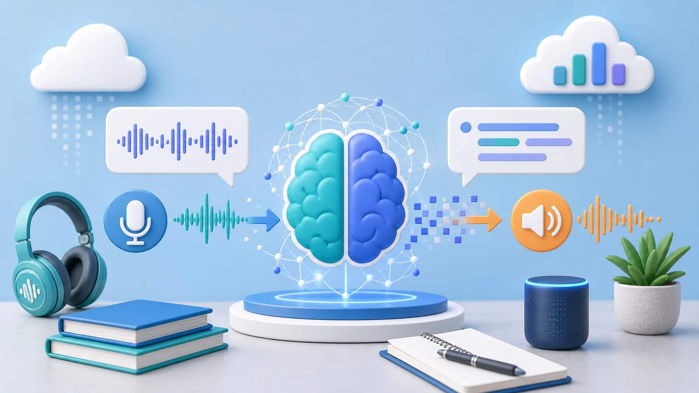

# Speech to Text Dashboard (คู่มือภาษาไทย)



แดชบอร์ด Streamlit (ธีมมืด, หน้าจอ ไทย / English) ที่แปลงไฟล์เสียง/วิดีโอภาษาไทยเป็นข้อความ `.txt` และ `.md` ที่สะอาด

> English version: [README.md](README.md)

| แท็บ (Tab) | ทำงานอย่างไร | สิ่งที่ต้องมี |
|-----------|--------------|--------------|
| **Auto 1 Click** | อัปโหลดไฟล์ได้หลายไฟล์ ระบบแปลงเป็น MP4 (ถ้าจำเป็น) อัปโหลดขึ้น YouTube รอ แล้วดึง transcript ให้อัตโนมัติ | อินเทอร์เน็ต, บัญชี Google, `client_secret.json` (ดูด้านล่าง) |
| **Online (YouTube)** | แปลงไฟล์เสียงเป็น MP4 อัปโหลดขึ้น **ช่อง YouTube ของคุณเอง** รอคำบรรยายภาษาไทยอัตโนมัติ (auto-captions) ที่ YouTube สร้าง แล้วดาวน์โหลด เร็วและไม่กินแรงเครื่อง | อินเทอร์เน็ต, บัญชี Google, `client_secret.json` |
| **Offline (Ultra HQ)** | อัปโหลดไฟล์ MP3, MP4, M4A, WAV, MKV หรือ WEBM ได้หลายไฟล์ (ไฟล์ละไม่เกิน **2 GB**) ถอดเสียงในเครื่องทีละไฟล์ด้วย `faster-whisper` **large-v3** ใช้ CPU เท่านั้น (`int8`) คุณภาพสูงสุดแต่ช้า | RAM ว่างประมาณ 6 GB, พื้นที่ดิสก์ประมาณ 3 GB สำหรับโมเดล |

## สิ่งที่ต้องมี (Requirements)

- **Python 3.10 – 3.13** (ยังไม่รองรับ 3.14 ขึ้นไป เพราะ `av` ยังไม่มี wheel)
- **ffmpeg** อยู่ใน PATH (ใช้กับตัวแปลง MP3 → MP4) Windows: `winget install Gyan.FFmpeg`, macOS: `brew install ffmpeg`, Linux/WSL: `sudo apt install ffmpeg`
- Windows, macOS, Linux หรือ WSL2 ไม่ต้องมี GPU

## ติดตั้งและรัน (Install & run)

```bash
git clone https://github.com/jatturongs-collab/speech-to-text.git
cd speech-to-text

python -m venv .venv
# Windows (PowerShell):  .venv\Scripts\Activate.ps1
# WSL / Linux / macOS:   source .venv/bin/activate

pip install -r requirements.txt
streamlit run app.py
```

เบราว์เซอร์จะเปิดที่ <http://localhost:8501> ใช้สวิตช์ **ไทย / English** ที่แถบซ้าย (sidebar) และปุ่ม **เปิดคู่มือ (README)** ที่แถบซ้ายเพื่ออ่านคู่มือนี้ในแอป

## ปิดหน้าเว็บแล้ว งานไม่หาย (Closed the page? Your uploads are not lost)

ทุกครั้งที่อัปโหลดขึ้น YouTube สำเร็จ แอปจะบันทึกลง `jobs.json` (และเก็บ transcript ที่ดึงได้ไว้ในโฟลเดอร์ `transcripts/`) ข้างไฟล์ `app.py` ทั้งสองอย่างอยู่ใน `.gitignore`

เมื่อเปิดแอปใหม่ แผง **งานที่อัปโหลดไว้ (Uploaded jobs)** ด้านบนจะแสดงงานเหล่านี้ สำหรับงานที่ยังรออยู่ แอปจะ **ตรวจ YouTube หนึ่งครั้งทันที** ถ้า transcript พร้อมแล้วจะมีธง 🚩 และปุ่มดาวน์โหลด `.txt` / `.md` ในแผง ส่วนงานที่ยังไม่พร้อมมีปุ่ม **ตรวจตอนนี้ (Check now)**

- การตรวจตอนเปิดแอปจะไม่เปิดหน้าต่างล็อกอิน วิดีโอแบบ Unlisted อ่านได้โดยไม่ต้องล็อกอิน วิดีโอแบบ Private ต้องใช้การล็อกอินที่บันทึกไว้ (`token.json`) ถ้าไม่ได้ ให้กด **ตรวจตอนนี้**
- ถ้าปิดหน้าเว็บ **ระหว่างที่ไฟล์ยังอัปโหลดไม่เสร็จ** การอัปโหลดนั้นไม่สมบูรณ์ ต้องเริ่มใหม่ งานจะถูกบันทึกก็ต่อเมื่ออัปโหลดเสร็จแล้ว
- เคยอัปโหลดไว้ก่อนมีฟีเจอร์นี้? ใช้แผง **วิดีโอในช่อง YouTube ของฉัน** แล้วกด **เพิ่มเป็น record และตรวจ transcript**

**ทำไมเห็นพอร์ตไม่เหมือนกัน?** Streamlit เปิดที่ `http://localhost:8501` หรือ 8502, 8503… ถ้า 8501 ถูกใช้อยู่โดยโปรแกรมเก่าที่ยังไม่ปิด แต่ละแท็บของเบราว์เซอร์คือ session แยกกัน ส่วนพอร์ตแบบสุ่มตอนล็อกอิน Google (เช่น `localhost:61503`) เป็นแค่ที่อยู่ชั่วคราวที่ Google ส่งกลับมา เป็นเรื่องปกติและปิดเองหลังล็อกอิน ทั้งสองอย่างไม่ทำให้เกิดปัญหา เพราะความคืบหน้าถูกเก็บในดิสก์ ไม่ได้อยู่ในหน้าเว็บ เคล็ดลับ: ปิดโปรแกรมเก่า (กด Ctrl+C ในหน้าต่าง PowerShell ของมัน) ก่อนเปิดตัวใหม่

## ปุ่มหยุด, ประวัติ (History log) และรายการวิดีโอในช่อง

- **ปุ่มหยุด / ยกเลิกงาน (Stop):** ทุกงานที่ใช้เวลานาน (Auto 1 Click, การอัปโหลดในแท็บ Online, การถอดเสียงแบบ Offline) จะมีปุ่ม **หยุด / ยกเลิกงาน** ขณะทำงาน กดแล้วงานหยุดทันที หยุดการแปลง MP3 → MP4 ที่กำลังทำอยู่ด้วย และบันทึกเหตุการณ์ลงประวัติ
  - ถ้าอัปโหลด **ยังไม่เสร็จ** จะไม่มีอะไรเหลือบน YouTube
  - ถ้าอัปโหลดเสร็จแล้ว วิดีโอยังอยู่ในช่องของคุณและงานจะแสดงสถานะ **หยุดแล้ว (Stopped)** ปุ่ม **ตรวจตอนนี้** ในรายการงานยังใช้ได้
  - Offline: ถ้าโมเดลกำลังดาวน์โหลดครั้งแรก การหยุดจะมีผลเมื่อดาวน์โหลดเสร็จ
- **ประวัติการทำงาน (History log):** แถบซ้ายมี **ประวัติการทำงาน (Log)** แสดงเหตุการณ์ล่าสุด (อัปโหลด, พบ transcript, การตรวจ, การหยุด, การลบ, ข้อผิดพลาด) **กดที่รายการ** เพื่อดูรายละเอียด (เวลา, ชื่อ, ลิงก์วิดีโอ, ข้อความ) ปุ่ม **ดูประวัติทั้งหมด** แสดงตารางเต็มและดาวน์โหลดไฟล์ log ได้ ไฟล์ log คือ `history.jsonl` ข้าง `app.py` (อยู่ใน `.gitignore`)
- **วิดีโอในช่อง YouTube ของฉัน:** เปิดแผงนี้ (ใต้รายการงาน) แล้วกด **โหลดรายการวิดีโอจากช่อง (ล่าสุด 50)** เพื่อดูวิดีโอที่เคยอัปโหลด รวมของเก่าก่อนมีแอปนี้
  - ติ๊กแถวที่ต้องการ (หรือ **เลือกทั้งหมด**) แล้วกด **เพิ่มเป็น record และตรวจ transcript** เพื่อเพิ่มวิดีโอเก่าเข้ารายการงานและดึง transcript
  - **ลบที่เลือกออกจาก YouTube** จะลบวิดีโอที่ติ๊กไว้ **ถาวร** หน้าต่างยืนยันจะแสดงรายชื่อ และต้องติ๊ก *ฉันเข้าใจว่าลบแล้วกู้คืนไม่ได้* ก่อนปุ่มลบจึงใช้งานได้ ปุ่มนี้ลบได้ทุกวิดีโอในช่อง ไม่ใช่เฉพาะที่แอปนี้อัปโหลด

## แท็บ Auto 1 Click

> [!CAUTION]
> 🚩 **ข้อกำหนดเบื้องต้น (Prerequisite): ต้องตั้งค่า `client_secret.json` ก่อน**
>
> แท็บนี้อัปโหลดขึ้นช่อง YouTube ของคุณ จึงใช้งานไม่ได้ถ้าไม่มีไฟล์ `client_secret.json` ข้างไฟล์ `app.py` ทำตามขั้นตอน [ตั้งค่า `client_secret.json`](#ตั้งค่า-client_secretjson-จำเป็นสำหรับการอัปโหลดอัตโนมัติ) (Set up `client_secret.json`) ด้านล่างก่อน ซึ่งทำครั้งเดียวพอ

ทางที่เร็วที่สุด: อัปโหลดไฟล์ **หนึ่งไฟล์หรือหลายไฟล์** แล้วปล่อยให้ระบบทำงาน **เมื่อเลือกไฟล์ ระบบจะเริ่มทำงานทันที โดยไม่ถามยืนยันซ้ำ**

ฟอร์แมตที่รองรับ: **MP3, M4A, WAV, MP4, MKV, WEBM** ขนาดอัปโหลดแทบไม่จำกัด (เพดานไฟล์ละ 20 GB) เพราะส่วนที่หนักคือการอัปโหลดขึ้น YouTube ซึ่งไม่ใช้เครื่องของคุณ ไฟล์จะถูกจัดการทีละไฟล์เป็นคิว (queue) และแต่ละไฟล์มีการ์ดผลลัพธ์ของตัวเอง

1. แปลงไฟล์เสียงล้วน (MP3, M4A, WAV หรือ MP4/MKV/WEBM ที่ไม่มีภาพ) เป็น MP4 พร้อมภาพสีดำ ส่วนวิดีโอจริงจะอัปโหลดตามเดิม
2. อัปโหลดขึ้นช่อง YouTube ของคุณแบบ **Unlisted**
3. รอครบตามเวลาที่ตั้งไว้ที่ slider (**15 – 90 นาที ค่าเริ่มต้น 30** นับจากอัปโหลดเสร็จ) ช่วงนี้ยังไม่ตรวจ
4. ตรวจหาคำบรรยายภาษาไทย ถ้ายังไม่พร้อม จะตรวจซ้ำทุก **5 นาที** (สูงสุด 6 ครั้ง แล้วหยุด ดู `AUTO_RETRY_INTERVAL_S` และ `AUTO_MAX_RETRIES` ใน `app.py`)
5. เมื่อพบ transcript ธง 🚩 จะกะพริบ และมีปุ่มดาวน์โหลด `.txt` / `.md`
6. ใต้ผลลัพธ์มีปุ่ม **ลบวิดีโอนี้ออกจาก YouTube** ใช้ลบวิดีโอที่อัปโหลดเมื่อไม่ต้องการแล้ว จะถามยืนยันก่อน และการลบ **ถาวร** transcript ที่แสดงในแดชบอร์ดแล้วยังอยู่จนกว่าจะปิดหน้านี้ จึงควรดาวน์โหลดก่อน (แท็บ Online มีปุ่มเดียวกัน) ใช้สิทธิ์ที่อนุญาตไว้แล้ว จึงไม่ต้องล็อกอินใหม่

ต้องเปิดหน้านี้ค้างไว้ระหว่างรอ

ข้อควรรู้เมื่อใช้หลายไฟล์:
- Streamlit เก็บไฟล์ที่อัปโหลดไว้ใน RAM ขณะเปิดหน้าเว็บ ถ้าไฟล์ใหญ่มากหรือมีจำนวนมาก ควรทยอยเพิ่มเป็นชุด
- โควต้า API ฟรีของ YouTube อัปโหลดได้ประมาณ **6 ไฟล์ต่อวัน** (ไฟล์ละราว 1,600 จาก 10,000 หน่วย) ถ้าโควต้าหมด ไฟล์ที่เหลือจะแสดง *ผิดพลาด (Failed)* พร้อมข้อความ ลองใหม่วันถัดไป
- **ปุ่มหยุด (Stop)** ยกเลิกทั้งชุด ไฟล์ที่ยังไม่อัปโหลดจะถูกข้าม ไฟล์ที่ขึ้น YouTube แล้วยังอยู่ในช่อง

## แท็บ Online: ทำงานอย่างไร

1. **Step 1** (เฉพาะเมื่อมีแต่ไฟล์เสียง): อัปโหลดไฟล์ MP3, M4A หรือ WAV แล้วกด **แปลงเป็น MP4** เพราะ YouTube ไม่รับไฟล์เสียงล้วน แอปจึงเติมภาพสีดำให้
2. **Step 2:** กด **อัปโหลดขึ้น YouTube และดึง Transcript** แอปจะ
   - ล็อกอิน Google (เบราว์เซอร์เปิดเฉพาะครั้งแรก)
   - อัปโหลด MP4 ขึ้นช่องของคุณแบบ **Unlisted** (หรือ **Private**)
   - ตรวจทุก 45 วินาทีว่ามี auto-captions ภาษาไทยหรือยัง (สูงสุด **15 นาที** พร้อมข้อความ "เวลาที่ผ่านไป" แบบสด)
   - แสดง transcript ที่ทำความสะอาดแล้ว พร้อมปุ่มดาวน์โหลด `.txt` และ `.md`
3. ถ้าครบ 15 นาทีแล้วยังไม่มีคำบรรยาย วิดีโอยังอยู่ในช่องของคุณ ใช้ปุ่ม **ตรวจอีกครั้ง (Check again)** ภายหลัง หรือช่อง "มีลิงก์ YouTube อยู่แล้ว?" แบบกรอกเอง

ไฟล์ขนาดสูงสุด **2 GB ต่อไฟล์** ทั้งตัวแปลงเสียงและช่องอัปโหลดวิดีโอ (MP4, MKV, WEBM) คุณอัปโหลดวิดีโอที่มีอยู่แล้วใน Step 2 แทนการแปลงไฟล์เสียงได้

## ตั้งค่า `client_secret.json` (จำเป็นสำหรับการอัปโหลดอัตโนมัติ)

> [!CAUTION]
> 🚩 **ทำครั้งเดียว แต่ขาดไม่ได้** ถ้าไม่มี `client_secret.json` แท็บ **Auto 1 Click** และ **Online** จะอัปโหลดขึ้น YouTube ไม่ได้

ไฟล์นี้ให้แอปมีสิทธิ์อัปโหลดขึ้นช่อง **ของคุณเอง**

1. ไปที่ <https://console.cloud.google.com/> แล้วล็อกอินด้วยบัญชี Google ที่เป็นเจ้าของช่อง YouTube
2. สร้างโปรเจกต์ (Project): แถบด้านบน → ตัวเลือกโปรเจกต์ → **New project** (ตั้งชื่ออะไรก็ได้ เช่น `transcription-dashboard`)
3. เปิดใช้ API: **APIs & Services → Library** → ค้นหา **YouTube Data API v3** → **Enable**
4. ตั้งค่าหน้าขอความยินยอม (Consent screen): **APIs & Services → OAuth consent screen** (หรือ *Google Auth Platform* → *Branding / Audience*)
   - User type: **External** กรอกชื่อแอปและอีเมลของคุณ
   - ที่ **Audience / Test users** ให้ **เพิ่มอีเมล Google ของคุณเองเป็น Test user** และปล่อยแอปในสถานะ *Testing*
5. สร้างข้อมูลรับรอง (Credentials): **APIs & Services → Credentials → Create credentials → OAuth client ID**
   - Application type: **Desktop app** ตั้งชื่ออะไรก็ได้
   - กด **Download JSON**
6. **เปลี่ยนชื่อไฟล์ที่ดาวน์โหลดเป็น `client_secret.json`** แล้ววางในโฟลเดอร์โปรเจกต์ (ข้าง `app.py`)
7. รันแอปแล้วกด **อัปโหลดขึ้น YouTube และดึง Transcript** (หรือเลือกไฟล์ใน Auto 1 Click) หน้าต่างเบราว์เซอร์จะเปิดขึ้น:
   - เลือกบัญชีของคุณ ถ้าเห็น *"Google hasn't verified this app"* ให้กด **Advanced → Go to … (unsafe)** เป็นเรื่องปกติสำหรับโปรเจกต์ส่วนตัวของคุณเอง
   - ติ๊กสิทธิ์ของ YouTube แล้วกดต่อ ระบบจะสร้างไฟล์ `token.json` เพื่อไม่ต้องถามอีก

> **เก็บ `client_secret.json` และ `token.json` เป็นความลับ** ทั้งสองไฟล์อยู่ใน `.gitignore` แล้ว ห้าม commit หรือส่งต่อให้ใคร

ข้อควรรู้ (Good to know):
- **โปรเจกต์ที่ยังไม่ได้รับการตรวจสอบ (unverified) จะบังคับอัปโหลดเป็น Private** แอปจัดการให้แล้ว: ถ้าช่องทางสาธารณะอ่านวิดีโอ Private ไม่ได้ แอปจะอ่านคำบรรยายผ่านบัญชีที่ล็อกอินของคุณแทน ถ้าต้องการ Unlisted จริง ๆ ต้องส่งโปรเจกต์ขอตรวจสอบ API (API audit) กับ Google ซึ่งเครื่องมือนี้ไม่จำเป็น
- **token ในโหมด Testing หมดอายุใน 7 วัน** แอปจะขอให้ล็อกอินใหม่เอง
- **โควต้า (Quota):** อัปโหลดหนึ่งไฟล์ใช้ราว 1,600 จาก 10,000 หน่วยฟรีต่อวัน จึงอัปโหลดได้ประมาณ 5–6 ไฟล์ต่อวัน
- หน้าต่างล็อกอินเปิดบนเครื่องที่รัน Streamlit จึงใช้ฟีเจอร์นี้ได้เมื่อรันแอป **ในเครื่องตัวเอง (local)** ไม่ใช่บนเซิร์ฟเวอร์ระยะไกล

## ค่าของแท็บ Offline (Offline tab settings)

`large-v3`, `device="cpu"`, `compute_type="int8"`, `language="th"`, `beam_size=5`, ตัวกรอง VAD เงียบขั้นต่ำ 500 ms, `condition_on_previous_text=False` (กันการพูดวนซ้ำ) และ initial prompt ที่เป็นศัพท์การเงินภาษาไทย (ดู `INITIAL_PROMPT` ใน `app.py` แก้ได้สำหรับสายงานอื่น) การรันครั้งแรกจะดาวน์โหลดโมเดลประมาณ 3 GB

## ฟอร์แมตที่รองรับและขีดจำกัดการอัปโหลด

| ที่ไหน | ฟอร์แมต | จำนวนไฟล์ | ขนาดสูงสุดต่อไฟล์ |
|-------|---------|-----------|------------------|
| Auto 1 Click | MP3, M4A, WAV, MP4, MKV, WEBM | หลายไฟล์ | 20 GB (แทบไม่จำกัด) |
| Online → ตัวแปลงเสียง | MP3, M4A, WAV | ไฟล์เดียว | 2 GB |
| Online → อัปโหลดวิดีโอ | MP4, MKV, WEBM | ไฟล์เดียว | 2 GB |
| Offline | MP3, MP4, M4A, WAV, MKV, WEBM | หลายไฟล์ | 2 GB |

ขีดจำกัดตั้งแยกตามช่องอัปโหลดใน `app.py` (`UPLOAD_MB_AUTO`, `UPLOAD_MB_OFFLINE`) และเพดานของเซิร์ฟเวอร์คือ `maxUploadSize` ใน `.streamlit/config.toml`

## หน้าตา (Appearance)

หน้าตาตั้งไว้ใน `.streamlit/config.toml` (สี, ฟอนต์, ขีดจำกัดการอัปโหลดของเซิร์ฟเวอร์) CSS ที่เพิ่มมีเพียงก้อนเล็ก ๆ เดียว (`tab_style()` ใน `app.py`) ที่ทำให้แท็บใหญ่ ตัวหนา และมีกรอบ โดยดึงสีจากธีมที่ใช้อยู่ มีสองธีม: **ธีมสว่างโทนครีม** (สีเน้นส้มอิฐ) และ **ธีมมืด** แบบเดิม โดยปกติ Streamlit จะทำตามค่า light/dark ของเครื่องคุณ ถ้าต้องการเลือกเอง ให้เปิดเมนู **⋮** (มุมขวาบน) แล้วเลือก **System / Light / Dark** เบราว์เซอร์จะจำค่าที่เลือกไว้ แก้ไขส่วน `[theme.light]` / `[theme.dark]` เพื่อปรับสีได้ และรัน `streamlit run app.py` จากโฟลเดอร์โปรเจกต์เพื่อให้อ่านไฟล์นี้

## แก้ปัญหา (Troubleshooting)

- `File must be 200MB or smaller` → ขีดจำกัดคือ `maxUploadSize` (หน่วย MB) ใน `.streamlit/config.toml` ต้องรีสตาร์ตหลังแก้
- `Failed to build 'av'` → คุณใช้ Python 3.14 ขึ้นไป ให้ใช้ 3.13 หรือต่ำกว่า
- `open() got an unexpected keyword argument 'metadata_errors'` → `av` ใหม่เกินไป รัน `pip install "av<17"`
- *client_secret.json not found* → ทำตามหัวข้อตั้งค่าด้านบน แล้ววางไฟล์ข้าง `app.py`
- *Access blocked / 403 access_not_configured* → ยังไม่ได้เปิด YouTube Data API v3 ในโปรเจกต์ หรืออีเมลของคุณไม่ได้อยู่ในรายชื่อ Test user
- *อัปโหลดสำเร็จ แต่ไม่มี transcript หลัง 15 นาที* → YouTube อาจช้า หรือจับเสียงพูดไม่ได้ กด **ตรวจอีกครั้ง** ภายหลัง และตรวจว่าวิดีโอมีคำบรรยายใน YouTube Studio หรือไม่
- *"The user has exceeded the number of videos they may upload" (`uploadLimitExceeded`)* → **ช่อง** YouTube ของคุณอัปโหลดครบจำนวนต่อวันที่ YouTube กำหนดแล้ว (ไม่ใช่โควต้า API) ทางเลือก: รอประมาณ 24 ชั่วโมง, ยืนยันช่องด้วยเบอร์โทรที่ <https://www.youtube.com/verify> (เพิ่มขีดจำกัด), หรือใช้บัญชี Google อื่น: กด **เปลี่ยนบัญชี Google** ที่แถบซ้าย เพิ่มอีเมลใหม่เป็น **Test user** ใน Google Cloud (consent screen → Audience) แล้วเริ่มอัปโหลดและเลือกบัญชีใหม่ วิดีโอและงานของบัญชีเดิมจะตรวจหรือลบจากบัญชีใหม่ไม่ได้
- Offline ช้า → เป็นเรื่องปกติเมื่อใช้โมเดล `large-v3` เต็มบน CPU ลองกับคลิปสั้นก่อน

## Claude Skill

`SKILL.md` ช่วยให้ Claude Code ดูแลและต่อยอดโปรเจกต์นี้ได้ คัดลอกไปไว้ที่ `.claude/skills/speech-to-text-dashboard/` (หรือโฟลเดอร์ skills ส่วนตัวของคุณ) เพื่อใช้งาน
